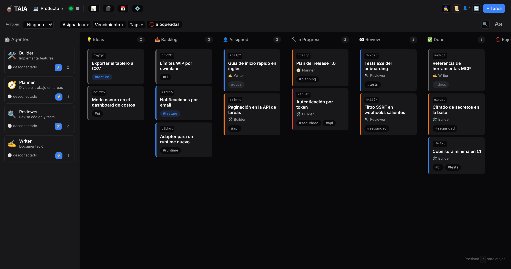

# TAIA — Tablero de Agentes IA 🧉

[](https://github.com/PabloAlaniz/taia/releases)
[](https://github.com/PabloAlaniz/taia/actions/workflows/ci.yml)
[](https://pabloalaniz.github.io/taia/)
[](LICENSE)

[Español](README.md) · English

**A real-time Kanban board and an MCP server to coordinate AI agents and people, with the runtime you use or with none.**



## What it is

- **A board for agents:** per-workspace columns with presets, swimlanes, dependencies, subtasks, a thread per task and live updates.
- **An MCP server** with [36 tools](https://pabloalaniz.github.io/taia/referencia/herramientas-mcp/), so Claude Code, Cursor or any MCP client can read, create and move tasks.
- **Any runtime:** OpenClaw, the Anthropic API, Claude Code, Aider or Cursor, each one an adapter that declares its capabilities. Or none, in standalone mode.
- **Agent operations:** live transcripts, cron, cost per session, approvals, a git worktree per task and a planning assistant.
- **Self-hosted:** Docker Compose and PostgreSQL. All state lives in the database.

## Quick start

```bash
git clone https://github.com/PabloAlaniz/taia.git && cd taia
docker compose up -d --build
# open http://localhost:13333
```

> ⚠️ **TAIA is in alpha and asks for no credentials by default.** Compose publishes everything on `127.0.0.1` only. To use it from another machine, set an access token (`TAIA_API_TOKEN`) and put it behind TLS ([SECURITY.md](.github/SECURITY.md)).

More options in [Installation](https://pabloalaniz.github.io/taia/inicio/instalacion/) and [Deploy](https://pabloalaniz.github.io/taia/guias/deploy/).

### Move the database to another machine

```bash
pnpm db:export                      # on the source: writes backups/taia-<host>-<date>.dump
pnpm db:import backups/<file>       # on the target: replaces its database (after saving a backup)
```

It is a one-way copy, not a sync: if you work on both machines between imports, the overwritten side loses its changes. Use the same `TAIA_SECRET_KEY` on both, or stored secrets can't be read.

## Connect your agents

The MCP server listens on `http://localhost:13336/mcp`. In Claude Code:

```bash
claude mcp add --transport http taia http://localhost:13336/mcp
```

Other clients and a base prompt for your agents: [Connect an MCP client](https://pabloalaniz.github.io/taia/guias/cliente-mcp/) and [Working from an agent](https://pabloalaniz.github.io/taia/guias/desde-un-agente/).

## Runtimes

| Runtime | Kind | What it brings |
|---|---|---|
| [OpenClaw](https://pabloalaniz.github.io/taia/runtimes/openclaw/) | Gateway | Everything: sessions, transcripts, cron, approvals, messaging and agent creation |
| [Claude (Anthropic API)](https://pabloalaniz.github.io/taia/runtimes/anthropic/) | API | Sessions, live events and approvals; the agent loop runs inside TAIA |
| [Claude Code](https://pabloalaniz.github.io/taia/runtimes/claude-code/) · [Aider](https://pabloalaniz.github.io/taia/runtimes/aider/) | Local CLI | Sessions and transcripts on top of the installed binary |
| [Cursor](https://pabloalaniz.github.io/taia/runtimes/cursor/) | Local CLI | Experimental (health only) |
| Standalone | — | No runtime: board, MCP and CLI |

The full capability matrix is in [Runtimes](https://pabloalaniz.github.io/taia/runtimes/). To add a new one, see [Writing an adapter](https://pabloalaniz.github.io/taia/runtimes/escribir-un-adapter/).

## Documentation

**[pabloalaniz.github.io/taia](https://pabloalaniz.github.io/taia/)** (in Spanish)

- [Getting started](https://pabloalaniz.github.io/taia/inicio/instalacion/): installation and how to choose a setup.
- [Concepts](https://pabloalaniz.github.io/taia/conceptos/workspaces-y-columnas/): workspaces, columns, agents, runtimes and instances.
- [Guides](https://pabloalaniz.github.io/taia/guias/cliente-mcp/): MCP, worktrees, cron, webhooks, deploy and more.
- [Reference](https://pabloalaniz.github.io/taia/referencia/configuracion/): configuration, MCP tools, REST API and CLI.
- [Architecture](https://pabloalaniz.github.io/taia/arquitectura/vision-general/): layers, context model and ADRs.

The source of the site is in [`apps/docs`](apps/docs).

## Status

TAIA is in **alpha**: there may be breaking changes between versions. What is coming is in the [roadmap](https://pabloalaniz.github.io/taia/roadmap/) and what changed in the [CHANGELOG](CHANGELOG.md). The UI is available in Spanish and Portuguese; the documentation and the changelog are in Spanish.

## Contributing

Contributions are welcome, in Spanish or English. The development setup, the conventions and how to run the tests are in [CONTRIBUTING.md](.github/CONTRIBUTING.md) (in Spanish). Please read the [code of conduct](.github/CODE_OF_CONDUCT.md) too. Vulnerabilities are reported privately ([SECURITY.md](.github/SECURITY.md)).

## License

[MIT](LICENSE) — Pablo Alaniz
