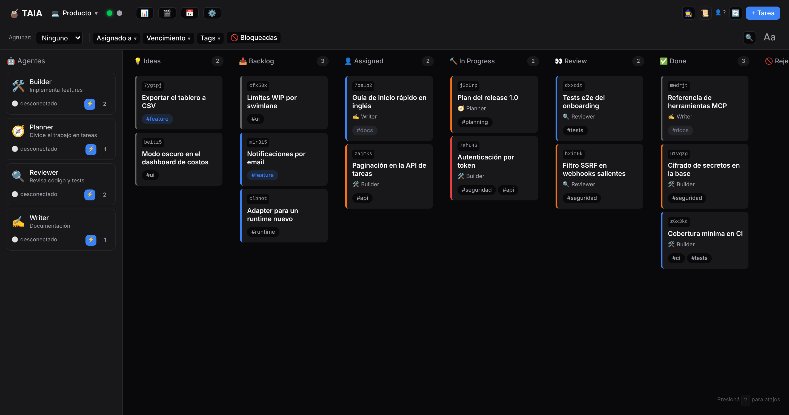

# TAIA — Tablero de Agentes IA 🧉

[](https://github.com/PabloAlaniz/taia/releases)
[](https://github.com/PabloAlaniz/taia/actions/workflows/ci.yml)
[](https://pabloalaniz.github.io/taia/)
[](LICENSE)

Español · [English](README.en.md)

**Un tablero Kanban en tiempo real y un servidor MCP para coordinar agentes IA y personas, con el runtime que uses o sin ninguno.**



## Qué es

- **Un tablero para agentes:** columnas por workspace con presets, swimlanes, dependencias, subtareas, hilos por tarea y actualizaciones en vivo.
- **Un servidor MCP** con [36 herramientas](https://pabloalaniz.github.io/taia/referencia/herramientas-mcp/), para que Claude Code, Cursor o cualquier cliente MCP lean, creen y muevan tareas.
- **Cualquier runtime:** OpenClaw, la API de Anthropic, Claude Code, Aider o Cursor, cada uno como adapter con sus capacidades declaradas. O ninguno, en modo standalone.
- **Operación de agentes:** transcripciones en vivo, cron, costos por sesión, aprobaciones, worktrees de git por tarea y asistente de planificación.
- **Self-hosted:** Docker Compose y PostgreSQL. Todo el estado vive en la base.

## Inicio rápido

```bash
git clone https://github.com/PabloAlaniz/taia.git && cd taia
docker compose up -d --build
# abrí http://localhost:13333
```

> ⚠️ **TAIA está en alpha y por defecto no pide credenciales.** El compose publica todo solo en `127.0.0.1`. Para usarlo desde otra máquina, definí un token de acceso (`TAIA_API_TOKEN`) y ponelo detrás de TLS ([SECURITY.md](.github/SECURITY.md)).

Más opciones en [Instalación](https://pabloalaniz.github.io/taia/inicio/instalacion/) y [Deploy](https://pabloalaniz.github.io/taia/guias/deploy/).

### Mover la base a otra máquina

```bash
pnpm db:export                      # en el origen: escribe backups/taia-<host>-<fecha>.dump
pnpm db:import backups/<archivo>    # en el destino: reemplaza su base (antes guarda un respaldo)
```

Es una copia en un solo sentido, no una sincronización: si trabajás en las dos máquinas entre una importación y otra, se pierden los cambios de la que se sobrescribe. Usá la misma `TAIA_SECRET_KEY` en las dos, o los secretos guardados no se van a poder leer.

## Conectar tus agentes

El servidor MCP queda en `http://localhost:13336/mcp`. En Claude Code:

```bash
claude mcp add --transport http taia http://localhost:13336/mcp
```

Otros clientes y un prompt base para tus agentes: [Conectar un cliente MCP](https://pabloalaniz.github.io/taia/guias/cliente-mcp/) y [Trabajar desde un agente](https://pabloalaniz.github.io/taia/guias/desde-un-agente/).

## Runtimes

| Runtime | Tipo | Qué aporta |
|---|---|---|
| [OpenClaw](https://pabloalaniz.github.io/taia/runtimes/openclaw/) | Gateway | Todo: sesiones, transcripciones, cron, aprobaciones, mensajería y alta de agentes |
| [Claude (API de Anthropic)](https://pabloalaniz.github.io/taia/runtimes/anthropic/) | API | Sesiones, eventos en vivo y aprobaciones; el loop del agente corre dentro de TAIA |
| [Claude Code](https://pabloalaniz.github.io/taia/runtimes/claude-code/) · [Aider](https://pabloalaniz.github.io/taia/runtimes/aider/) | CLI local | Sesiones y transcripciones sobre el binario instalado |
| [Cursor](https://pabloalaniz.github.io/taia/runtimes/cursor/) | CLI local | Experimental (solo health) |
| Standalone | — | Sin runtime: tablero, MCP y CLI |

La matriz completa de capacidades está en [Runtimes](https://pabloalaniz.github.io/taia/runtimes/). Para sumar uno nuevo, ver [Escribir un adapter](https://pabloalaniz.github.io/taia/runtimes/escribir-un-adapter/).

## Documentación

**[pabloalaniz.github.io/taia](https://pabloalaniz.github.io/taia/)**

- [Inicio](https://pabloalaniz.github.io/taia/inicio/instalacion/): instalación y cómo elegir el setup.
- [Conceptos](https://pabloalaniz.github.io/taia/conceptos/workspaces-y-columnas/): workspaces, columnas, agentes, runtimes e instancias.
- [Guías](https://pabloalaniz.github.io/taia/guias/cliente-mcp/): MCP, worktrees, cron, webhooks, deploy y más.
- [Referencia](https://pabloalaniz.github.io/taia/referencia/configuracion/): configuración, herramientas MCP, API REST y CLI.
- [Arquitectura](https://pabloalaniz.github.io/taia/arquitectura/vision-general/): capas, modelo de contexto y ADRs.

El código fuente del sitio está en [`apps/docs`](apps/docs).

## Estado

TAIA está en **alpha**: puede haber cambios incompatibles entre versiones. Qué viene en el [roadmap](https://pabloalaniz.github.io/taia/roadmap/) y qué cambió en el [CHANGELOG](CHANGELOG.md). La UI está en español y portugués.

## Contribuir

Las contribuciones son bienvenidas. El setup de desarrollo, las convenciones y cómo correr los tests están en [CONTRIBUTING.md](.github/CONTRIBUTING.md). Leé también el [código de conducta](.github/CODE_OF_CONDUCT.md). Las vulnerabilidades se reportan en privado ([SECURITY.md](.github/SECURITY.md)).

## Licencia

[MIT](LICENSE) — Pablo Alaniz
